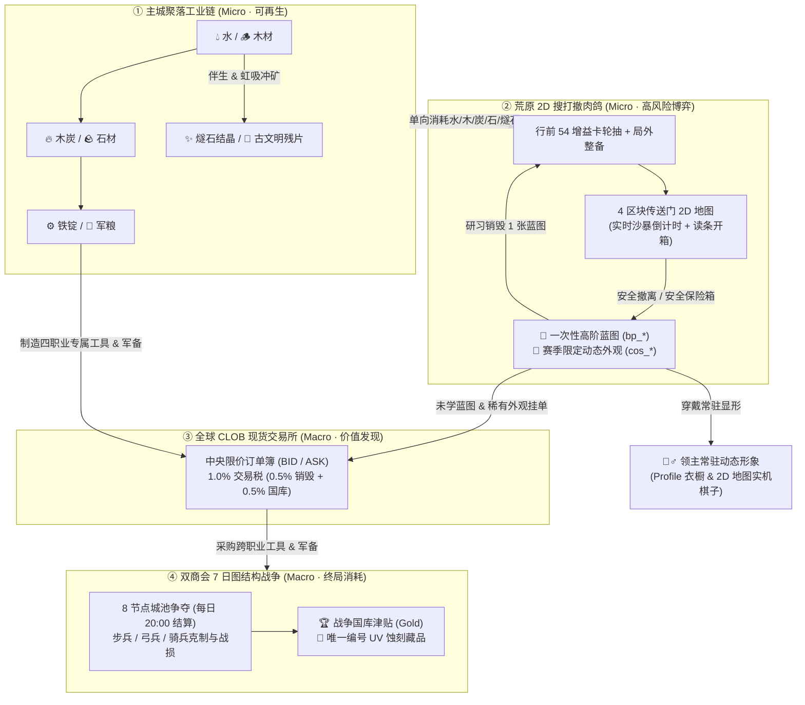

# 整体设计 II：生命周期三阶段与系统耦合总纲 (Lifecycle & Core Loops)

> **层级定位**：`01-overall`（整体设计层 · 跨赛季恒定公理）  
> **职责边界**：定义玩家从第 0 秒到赛季终局的 **三阶段生命周期 (Phase 1 / Phase 2 / Phase 3)**，以及【主城聚落】、【荒原肉鸽】、【现货市场】、【商会战争】四大子系统的全局资源流向与边界。

---

## 1. 玩家生命周期三阶段 (Three-Phase Progression Lifecycle)

| 阶段 | 时间跨度 | 核心体验目标 | 开放的核心系统 | 阶段毕业里程碑 |
| :--- | :---: | :--- | :--- | :--- |
| **Phase 1 · 荒原破局期** *(Settlement Awakening)* | `0 – 30 分钟` | 从手点打水到自动化多产线耦合，体验人口维持费、仓储扩容、政令切换与首次荒原摸金 | 手动/自动汲水、伐木、烧炭、采石、17 级基建蓝图、4 大聚落政令、游商驿站、荒原 2D 搜打撤肉鸽 | 达到 `40 人口`，锻造宝藏三部件并开启【神秘的宝藏】，获赠首批 `500 Gold` |
| **Phase 2 · 专精与贸易期** *(Specialization & Spot Market)* | `30 分钟 – 3 天` | 选择终身职业，建立跨职业工具互补与高阶肉鸽蓝图/外观交易网 | 四大终身职业、炼铁/制粮军工产线、跨职业 4 槽设备架、CLOB 现货限价订单簿、局外 T2/T3 肉鸽军械打造 | 集齐四职业专精工具槽（全产能叠加 `+265%`），解锁 3~5 格赛季安全保险箱 |
| **Phase 3 · 帝国争霸期** *(Chamber War & Seasonal Prestige)* | `第 3 天 – 赛季末` | 将工业产能转化为三军军备，参与每晚 20:00 商会领土决战，竞逐赛季传世外观与唯一编号藏品 | 黑曜/白银双商会结盟、8 节点图拓扑补给线行军、每日 20:00 权威战争结算、S1 动态形象衣橱与程序化 UV 藏品铸造 | 统帅商会占领【中央宝藏城 ★】，集齐当季传世 (`Legendary`) 动态外观套装 |

---

## 2. 四大核心子系统全局耦合拓扑图

《滴水成城》严格区分**「可再生工业循环」**与**「不可再生稀缺荣誉循环」**，通过单向消耗漏斗防止通货膨胀：

---

## 3. 四维策划案分层矩阵 (4D Documentation Taxonomy)

为保证长期迭代中工程实现与策划案严格对齐，所有游戏设计拆分为以下四个正交维度：

| 维度 | 关注尺度 | 跨赛季稳定性 | 核心回答的问题 | 对应目录 |
| :--- | :--- | :--- | :--- | :--- |
| **01 · 整体设计 (`Overall`)** | 全局顶层 | **跨赛季恒定** | 这款游戏的核心乐趣支柱、信息披露法则、玩家生命周期是什么？ | [`docs/design/01-overall/`](./) |
| **02 · 宏观设计 (`Macro`)** | 全服多玩家 | **跨赛季恒定** | 全服货币如何守恒？CLOB 市场如何撮合？四职业如何分工？商会领土战如何结算？ | [`docs/design/02-macro/`](../02-macro/) |
| **03 · 微观设计 (`Micro`)** | 单人单局 | **机制恒定、参数微调** | 聚落产线怎么耦合？2D 传送门肉鸽怎么移动/读条/保底？54 张增益卡和局外装备如何运作？ | [`docs/design/03-micro/`](../03-micro/) |
| **04 · 赛季设计 (`Seasonal`)** | 赛季周期 | **每赛季独立更替** | 赛季重置什么、保留什么？S1 赛季专属的 12 款限定动态外观、高阶蓝图池、荒原生态是什么？ | [`docs/design/04-seasons/`](../04-seasons/) |
