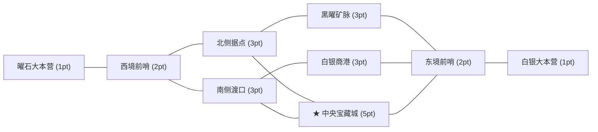

# 宏观设计 III：双商会 7 日图结构领土战争 (Macro Chamber Territory War)

> **层级定位**：`02-macro`（宏观设计层 · 公会协同组织、全服阵营对抗与终局资源消耗）  
> **职责边界**：定义黑曜商会 (`OBSIDIAN`) 与白银同盟 (`ARGENT`) 麾下的玩家公会系统 (`GuildState`)、公会后勤/军费捐献、集结令战术标定、8 节点图拓扑地图、补给线连通性校验、三兵种加权克制矩阵与每日 20:00 权威战争结算。  
> **代码映射**：[`services/game/internal/domain/macro_war.go`](../../../services/game/internal/domain/macro_war.go)、[`apps/web/src/MacroEmpireWorkspace.tsx`](../../../apps/web/src/MacroEmpireWorkspace.tsx)、[`apps/web/src/WarGraphMapSVG.tsx`](../../../apps/web/src/WarGraphMapSVG.tsx)

---

## 0. 公会大厅与集结协同体系 (`GuildState` & `PerformGuildAction`)

战区城池争夺以**公会 (`Guild`)** 为基本作战建制。领主完成圣坛择业后，须在【公会与战区】场景中加入现有公会或创立新公会，方可代表所属商会向战区派兵：

| 公会机制 | 规则与数值说明 |
| :--- | :--- |
| **四大常驻初始公会** | 黑曜商会麾下：**`[INK] 墨械先驱团`**、**`[IRON] 黑曜铁卫公会`**；白银同盟麾下：**`[ASTR] 白银星界议会`**、**`[ALCH] 赫尔墨斯炼金会`**。 |
| **创立新公会 (`create`)** | 消耗驻地建材（`清水 100 + 木材 60 + 石料 30`），自定义 `2~16` 字公会名、`2~4` 位徽标简称 (`Tag`) 与效忠商会 (`OBSIDIAN` / `ARGENT`)。 |
| **后勤物资捐献 (`donate_supplies`)** | 消耗 `清水 80 + 木材 50 + 石料 25` $\rightarrow$ 公会经验 `+120 XP`、个人公会贡献 `+100`、活动积分 `+15`。 |
| **金库军费捐献 (`donate_gold`)** | 消耗 `50.0000 Gold`（等额划入中央/公会金库 $M_{\text{treasury}}$，严格保持宏观货币恒等式守恒）$\rightarrow$ 公会经验 `+200 XP`、个人公会贡献 `+180`、活动积分 `+25`。 |
| **公会集结令 (`set_rally`)** | 标定 8 节点沙盘上的优先攻坚城池（`rallyNodeId`）。公会成员向集结目标城池派兵时，立即额外获得 **`+5` 活动积分**与公会战旗加成。 |

---

## 1. 8 节点 10 边战略图拓扑 (`WarNodeCatalog`)

战争沙盘由 **8 座战略城池节点**与 **10 条双向补给通道**构成：

| 节点 ID (`nodeId`) | 节点名称 | 战略分值 (`points`) | 初始归属 | 驻防加成 (`defenseBonusPct`) | 相邻连通节点 (`neighbors`) |
| :--- | :--- | :---: | :---: | :---: | :--- |
| `node_obsidian_hq` | **曜石大本营** | `1` | `obsidian` | `+25%` | `node_west_outpost` |
| `node_west_outpost` | **西境前哨** | `2` | `obsidian` | `+25%` | `node_obsidian_hq`, `node_north_fort`, `node_south_crossing` |
| `node_north_fort` | **北侧据点** | `3` | `obsidian` | `+25%` | `node_west_outpost`, `node_central_treasure`, `node_iron_mine` |
| `node_south_crossing` | **南侧渡口** | `3` | `neutral` | `+25%` | `node_west_outpost`, `node_central_treasure`, `node_trade_port` |
| `node_central_treasure` | **中央宝藏城 ★** | `5` | `neutral` | `+25%` | `node_north_fort`, `node_south_crossing`, `node_east_outpost` |
| `node_iron_mine` | **黑曜矿脉** | `3` | `neutral` | `+25%` | `node_north_fort`, `node_east_outpost` |
| `node_trade_port` | **白银商港** | `3` | `argent` | `+25%` | `node_south_crossing`, `node_east_outpost` |
| `node_east_outpost` | **东境前哨** | `2` | `argent` | `+25%` | `node_central_treasure`, `node_iron_mine`, `node_trade_port`, `node_argent_hq` |
| `node_argent_hq` | **白银大本营** | `1` | `argent` | `+25%` | `node_east_outpost` |

### 补给线连通性铁律 (`SupplyLineConnected`)
玩家仅可向满足以下任一条件的城池派兵：
1. 该城池当前已归属本方商会（驻防）；
2. 该城池与至少一座本方商会已占领的城池直接相连（进攻接壤城池）。

---

## 2. 每日军备预算与三兵种加权克制矩阵

### 2.1 个人每日派兵预算上限 (`100 Pts/Day`)
为防止单一巨鲸无上限堆兵碾压，每位领主每个战争日拥有 **100 点行军预算 (`DailyBudgetMax = 100`)**：

| 兵种 | 消耗军备道具 | 单团预算占用 | 单团基础战力 (`BasePower`) | 克制关系 |
| :--- | :--- | :---: | :---: | :--- |
| **步兵团 (`Infantry`)** | `1 × 步兵重甲 (infantry_gear)` | `10 点` | `100` | 克制骑兵 (`1.15x`)，被弓兵克制 (`0.90x`) |
| **弓兵团 (`Archer`)** | `1 × 弓兵连弩 (archer_gear)` | `12 点` | `120` | 克制步兵 (`1.15x`)，被骑兵克制 (`0.90x`) |
| **骑兵团 (`Cavalry`)** | `1 × 骑兵具装 (cavalry_gear)` | `15 点` | `150` | 克制弓兵 (`1.15x`)，被步兵克制 (`0.90x`) |

### 2.2 城池战力修正公式
设一方在某城池投入的步、弓、骑基础战力分别为 $P_I, P_A, P_C$，总基础战力 $P = P_I + P_A + P_C$；对手三兵种占比为 $w'_I, w'_A, w'_C$：
1. **兵种克制乘数** $M_{\text{counter}}$：
   $$M_{\text{counter}, I} = 1.00 \cdot w'_I + 0.90 \cdot w'_A + 1.15 \cdot w'_C$$
   （弓、骑同理循环克制）
2. **守城防御乘数** $M_{\text{def}}$：若该城池当前归属本方商会，额外获得 **`+25%` 城防加成** ($M_{\text{def}} = 1.25$)。
3. **最终结算战力**：$P_{\text{effective}} = \lfloor P_{\text{counter}} \times M_{\text{def}} \rfloor$。

---

## 3. 每日 20:00 权威结算与战损/津贴分配 (`TriggerWarSettlement`)

每晚 20:00（或由管理员在隧道后台触发），系统对所有城池执行原子结算：
1. **城池易手判定**：在每座城池比较黑曜有效战力 $P_{\text{obs}}$ 与白银有效战力 $P_{\text{arg}}$，高者夺取城池控制权。
2. **军备硬性战损（核心工业消耗池）**：
   - **胜方驻军**：损毁 **`20%`** 军备，其余 `80%` 完好保留。
   - **败方驻军**：损毁 **`40%`** 军备，其余 `60%` 退回。
3. **战争津贴与活动点数发放**：
   - 参战领主获得 **`+120` 战争活动积分 (`ActivityPoints`)**（满 `80 分` 可铸造 1 枚唯一序列号赛季藏品）与 **`+85.0000 Gold` 战争津贴**（优先从中央国库 $M_{\text{treasury}}$ 拨付，严格保持宏观货币恒等式守恒）。
   - 每 7 个战争日构成一个完整战役周 (`D1 ~ D7`)，累计战略总分高者加冕当周霸主商会。
