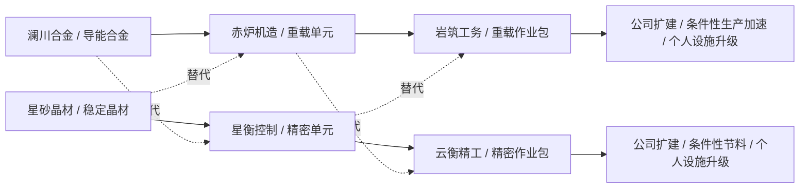

# 宏观设计：稀缺公司、供应链与股东治理

## 准入与 IPO

首版目录限定六家公司，每个 ID 同时至多一家，禁止玩家创建公司。策划选择引入时点、发行股数、每股价、成功下限与认购期限；经营执行由服务器按股东方案自动完成。没有玩家总经理私下提款入口。

发行 1,000–1,000,000 股，每股 0.01–10,000 Gold；认购 1–336 小时，最低认购量至少发行量的一半。玩家选择职业后可认购，累计个人申请不超过本次发行量，认购即把现金转到独立 IPO 托管。

截止时：未达下限全额退款，可由策划重新引入；达下限则发行 `min(认购总量,发行上限)`。超额按比例并用最大余数法分配整数股，余数相同按 handle 排序；未获配部分退款，获配资金进入公司现金。公司按目录获得一条专有产线，其获得并不额外铸造金币。该初始许可是策划引入的稀缺资产，不是募资前收入。

上市股份使用 `share:<companyId>`，复用同一撮合、托管、税和持久审计。二级市场买款付给卖股者，公司现金不变。首版不做借贷、保证金、增发、回购、破产清算或无限扩张；无现金公司暂停，股权保留。

## 公司供应链

所有箭头均为现货市场成交，没有后台无偿调拨。普通原料也按市场买卖，无指定玩家。完整投入、产物及替代成本见 [S1 目录](../04-seasons/s1-industry-catalog.md)。

公司每分钟按持久化游标结算；后台时钟与玩家请求共用同一游标，多个进程和重复请求不能多产。最长补算八小时，超出时间不补产。每次开工先检查整批缺料的可执行卖盘，全部可得且现金足够才采购，避免只囤一半原料。投入的历史成本和按批摊销耗材成本均计入批次预算，且必须小于预计税后销售收入。亏损或断供暂停，不透支。

每条活动产线最多积压两批产物，计算包括现货、卖单冻结及在制品；新一批会超过上限就等待销售。价格调整只撤重挂本公司产物卖单，价格不变保持原时间优先级。原料涨价时不会擅自扩大预算或抬价，股东需调整方案。

## 股东投票

上市七天后开放首次提案。持有至少 1% 股份者可以发起，每次开启后下一窗口为七天后，投票持续 24 小时；首版每个窗口只有一个整体经营方案。提案未发起时维持原计划。

提案时冻结所有股东票权快照，包含卖单冻结股份；股份随后转让不增加票数。快照股东可在截止前修改赞成/反对，表决需至少 25% 总股本参与且赞成大于反对。结果与完整快照追加审计。首版不限制最大持股比例，也不保证股权分散；产品替代、个人普通升级路线和策划准入控制供应链依赖，不能把它描述成全面消除垄断。

| 可决策事项 | 执行边界 |
| --- | --- |
| 标准/替代配方 | 只能选本公司的既定目录，不能新增专有物品 |
| 开工产线数 | 0 到已建产线数；0 表示暂停新批次，已开工批次照常完成 |
| 产品价格、批次投入预算 | 有界定点数，无保价成交承诺 |
| 生产耗材 | 不用、重载或精密；实际有收益且能买到才用，已付款剩余批次不能叠加 |
| 扩建 | 普通材料 + 40 个任一种作业包，最多四条；先批准现金预算，全部材料可成交才一起采购建成 |
| 调减/取消待建项目 | 新方案可替换路线与预算，`cancel` 且预算 0 释放待建预算；已完成设施不可撤销回款 |
| 分红 | 只从累计已实现利润减去已分红金额中分配，并保留两批运营预算及待建预算 |

执行表决时重新校验全部现金条件，任一不满足整案不执行，保留旧方案。分红按实际执行时的当前持股（含卖单托管）比例发放；票权快照只决定表决资格。整数舍入余款留公司。扩建批准与新增产线启用是分开的；建成后下个经营提案可提高活动产线数。

公司存货采用加权历史成本，销售时确认税后收入减成本。筹资和未卖货品不构成利润。建设投入体现为产线资产与现金支出，首版未做折旧、资产减值或资产净值报价；界面“已实现利润”不能解读为完整财务报表净利润。

## 持续性

普通内容赛季保留公司现金、存货、产线、订单、IPO、股份、待表决方案及货币联盟账本。玩家材料进度重置前撤销其订单、返还金币/股份；已有金融头寸的单账号重置被拒绝。完整新经济清档需停服切换数据库，不能在运行中逐个清玩家。
