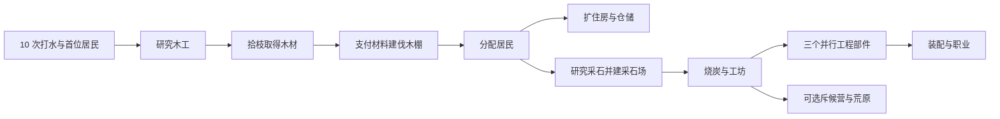

# 微观设计 I：聚落研究、建设与生产

> 层级：03-micro。定义单人聚落的技术、设施、岗位、仓储、改良、工程与游商。
> 实现：`services/game/internal/domain/balance_construction.go`、`balance_settlement.go`、`micro_construction.go`、`micro_settlement.go`。界面：`apps/web/src/SettlementPanel.tsx`。

## 1. 三种独立行为

研究一次技术只开放建造权限；每座设施单独支付材料；生产设施提供岗位，居民上岗才产生资源。没有施工倒计时、研究币或主线随机图纸。荒原中的 `bp_*` 仍是独立的、消耗一张后学会配方的道具。

初始营地提供 4 个住房名额。第一位居民默认打水；同时开放永久保留的单人拾枝岗位（0.15 木/秒），取得首座伐木棚需要的 10 木。即使把木材用完，仍可用拾枝恢复生产链。研究、建造均不自动调岗。

## 2. 人口、岗位与资源

招募仍消耗水：当前人口 N < 40 时为 `ceil(10 × 1.12^N)`，N >= 40 时为 `ceil(931 + 55 × (N - 39)^1.32)`，单位为整水。住房已满不能招募；批量招募最多 50 人，逐人结算直到材料或住房不足。游商带来的两名居民也必须有两个空床位，不能绕过住房上限。

人口达到 2 时，每人每秒饮水 0.18；断水使非打水岗位效率降为 50%，不杀死居民。分配必须同时满足总人口与各岗位容量。所有分配模式及保存预设都受相同约束，多余居民可回到打水岗位。

| 岗位 | 基础产出/人/秒 | 原料/人/秒 | 岗位来源 |
| --- | --- | --- | --- |
| 拾枝 | 0.15 木 | 无 | 首位居民后 1 个，不产伴生物 |
| 打水 | 2 水 | 无 | 最多当前总人口 |
| 伐木 | 0.45 木 | 无 | 每座伐木棚 3 个 |
| 采石 | 0.22 石 | 无 | 每座采石场 3 个 |
| 烧炭 | 0.28 炭 | 0.30 木 | 每座炭窑 2 个 |
| 炼铁 | 0.11 铁 | 0.18 石 + 0.10 炭 | 工坊建成且选职业后，最多总人口 |
| 制粮 | 0.15 军粮 | 0.22 水 + 0.10 木 | 工坊建成且选职业后，最多总人口 |

伐木按木产量的 1/30 伴生燧石；采石按石产量的 1/16 伴生燧石、1/45 伴生残片；石刃改良使这些伴生量翻倍。汲水改良后手点为 2 水/次，每 4 次获得 0.5 燧石。手点仍受服务端频率限制。

资源以整数 milli 存储。资源一旦发现就保持可见，即使库存花到零；首位居民出现后展示木材。游商只展示支付项与产出项均已认识的契约，不能提前暴露未知资源。

## 3. 技术：一次研究，开放权限

以下数字均为整单位材料。

| 技术 | 前置 | 研究成本 | 开放 |
| --- | --- | --- | --- |
| 基础木工 `woodworking` | 首位居民 | 20 水 | 伐木棚、木屋、蓄水池、堆场 |
| 采石技术 `mining` | 首座伐木棚 | 40 水 + 10 木 | 采石场 |
| 烧炭技术 `charcoal` | 首座采石场 | 40 水 + 10 木 | 炭窑，炭窑建成后可造斥候营 |
| 水利技术 `hydraulics` | 首座采石场 | 80 水 + 20 木 + 10 石 | 引水轮、虹吸冲矿槽 |
| 机械装配 `mechanics` | 首座炭窑 | 150 水 + 40 木 + 20 石 | 基础工坊与工程链 |

## 4. 建设：数量、材料与容量

| 设施代码 | 首座成本 | 效果 | 限制 |
| --- | --- | --- | --- |
| `lumber_camp` 伐木棚 | 20 水 + 10 木 | +3 伐木岗位 | 可重复 |
| `house` 木屋 | 30 水 + 15 木 | +4 住房 | 可重复 |
| `water_cistern` 蓄水池 | 60 水 + 25 木 | +500 水仓容 | 可重复 |
| `lumber_yard` 物资堆场 | 40 水 + 40 木 | +300 木、+200 石、+100 炭仓容 | 可重复 |
| `quarry` 采石场 | 60 水 + 30 木 | +3 采石岗位；首座不需石材 | 可重复 |
| `charcoal_kiln` 炭窑 | 60 水 + 30 木 + 20 石 | +2 烧炭岗位 | 可重复 |
| `colony_edicts` 议事所 | 80 水 + 40 木 + 10 石 | 夜班与节水政令 | 木工、采石场，唯一 |
| `caravan_post` 游商驿站 | 80 水 + 40 木 | 已认识资源的易物 | 木工、伐木棚，唯一 |
| `water_wheel_1` 引水轮 | 200 水 + 80 木 + 40 石 | 取水效率 +25%、水压机关 | 水利，唯一 |
| `siphon_sluice` 虹吸冲矿槽 | 200 水 + 80 木 + 40 石 | 开放溢出转化开关 | 水利、引水轮，唯一 |
| `basic_workshop` 基础工坊 | 400 水 + 180 木 + 100 石 + 40 炭 | 开放三个并行部件 | 机械装配，唯一 |
| `scout_camp` 荒原斥候营 | 200 水 + 100 木 + 40 石 + 20 炭 | 可选的荒原整备与探索 | 烧炭技术、炭窑，唯一 |

重复设施按已拥有数量 n 定价：每种材料为 `ceil(首座整单位成本 × (5/4)^n)`，精确有理数计算并分别取整，不递推已经取整的上一座价格。例如伐木棚第二座 25 水 + 13 木，第三座 32 水 + 16 木。接口每批 1–20 座、每种最多 128 座；批量逐座计算总价，全部材料足够才原子扣款。成本还受安全整数边界限制。

基础仓容：水 250、木 450、石 350、炭 250、燧石/残片/陨铁各 500、铁/军粮各 2000。实际仓容 = 基础 + 已建仓储设施增量。仓储改良只将设施增量翻倍。工坊、引水轮不会免费扩大仓储。成本大于仓容时明确提示扩仓，不能展示可达的倒计时。

## 5. 改良与工程

| 代码 | 前置 | 成本 | 立即生效 |
| --- | --- | --- | --- |
| `first_resident` 汲水改良 | 首位居民 | 15 水 | 手点升级，不提供住房 |
| `charcoal_improvement` 炭化改良 | 炭窑 | 80 水 + 40 木 + 20 石 + 10 炭 | 烧炭 +20% |
| `stone_vault` 仓储改良 | 采石场 | 200 水 + 100 木 + 60 石 | 蓄水池与堆场仓容增量翻倍 |
| `stone_saw_1` 石刃改良 | 炭窑 | 120 水 + 80 木 + 40 石 + 20 炭 | 伐木/采石 +25%，伴生翻倍 |
| `part_valve` 导水阀芯 | 工坊 | 300 水 + 60 木 + 20 石 + 10 炭 | 取水 +20% |
| `part_frame` 承压木框 | 工坊 | 100 水 + 100 木 + 30 石 + 15 炭 | 伐木 +25% |
| `part_tablet` 铭文石板 | 工坊 | 160 水 + 40 木 + 70 石 + 20 炭 | 采石 +30% |
| `mystery_treasure` 装配古代装置 | 三个部件全部完成 | 无额外材料 | 一次性 500 Gold，开放职业 |

三个部件没有顺序与 40 人口要求。缺哪种产能就先制造相应部件。装配奖励通过原有发行账本计入，不可重复领取。

## 6. 政令与游商

议事所开放互斥的夜班（常规采集/工业岗位 +45%，每人额外耗水 0.14/秒，另耗木 0.40/秒）与节水（每人少耗水 0.09/秒，常规岗位效率 -15%）。水轮开放水压机关（伐木/烧炭 +40%，耗水 1.50/秒）。

夜班与水压机关在每个一秒结算步开始时检查对应期初库存（夜班至少 0.40 木，水压机关至少 1.50 水）：足额才给予该步完整加成并收取完整费用；不足时该步的加成、固定资源扣款与额外饮水全部暂停，保留玩家开启设置，补足后自动恢复。同一步尚未产生的采集产出不能提前抵扣固定维持费。费用先于烧炭等转化岗位扣除，不能重复使用同一份原料。资源速率预览采用相同条件。

虹吸设施建成后仍需玩家主动开启，净水在扣除人口、政令及制粮转化后的实际净溢出按 10:1 转石、80:1 转燧石。

| 契约 | 支付 | 获得 |
| --- | --- | --- |
| 燧石换木料 | 3 燧石 | 12 木 + 10 水 |
| 原木易石 | 80 木 | 25 石 + 1 燧石 |
| 燃料换拓片 | 20 炭 | 1 残片 + 80 水 |
| 流民安置 | 5 燧石 + 50 木 | 2 居民，要求两个空住房 |
| 古物折抵 | 2 残片 | 20 水 + 10 木 + 4 石 |

资源易物按同一组正权重（当前资源指导价）检验产出价值严格小于投入价值，因此组合即时兑换不能形成无成本增殖循环；它是应急换料渠道。人口契约另受住房约束。荒原不是取得主线部件或建筑权限的前置。

## 7. 状态与界面

技术集合、建筑数量、发现资源与命令序号分别持久化；`UnlockedBlueprints` 保存设施完成效果、改良和工程标记。设施不能通过通用解锁接口免费取得。

建设与研究使用 `commandSeq`，只允许上一序号 +1；最新同序号同内容重放只返回状态，改变内容、跳号或过期序号拒绝。事务包含材料、建筑、序号和存档。重置递增序号并清空最近签名，阻断旧页面请求跨赛季执行。

主界面以资源、岗位、发展三栏经营为核心。发展区分建设、技术与工程、已建驿站后的游商；成本显示当前/所需、仓容障碍与预计等待提示。设施明确显示已掌握未建造、待分配、生产、缺料或满仓。未完成前置的技术/设施不展示；已完成项折叠。常驻简短里程碑和可折叠纪事，调岗不使章节倒退。仅毕业弹出一次章节提示；公告、工坊、市场、战区等在各自阶段开放，世界舆图只作为已开放区域的导航。

## 8. 确定性结算与原料守恒

服务端按一秒模拟步结算，`simulatedRemainderMs` 保存未满一秒的模拟时间，`productionRemainders` 保存不足一个 milli 的整数余数。一次结算 60 秒、60 次一秒或 600 次 100ms，在无其他操作时必须得到相同库存及模拟时钟。改变岗位/政令前先结算完整时间步；不足一秒的时间保留至下一步，下一步使用当时配置。单次离线补算仍最多八小时。

每步先按期初库存确定夜班与水压机关是否足额供能，再采集水/木/石及伴生物，支付人口与本步有效政令消耗，转换岗位按烧炭、炼铁、制粮顺序，按实际可用原料计算可运行的工时，先扣原料再加产出，最后将净水实际净溢出用于虹吸并按仓容上限截断各资源净盈余。缺料允许部分工时，不允许先生成整段产出再把负原料库存钳制为零。合法市场购买导致的超仓库存不会被下一次被动生产截断。仅当前操作玩家补算，其他玩家的离线时间不被他人的请求重置。

## 9. 节奏验证

新玩家 30–45 分钟建立完整经营循环是待试玩验证的目标，不是已测得的完成时间。真实领域模拟每 10 秒做一次决策，仅开局提供 10 次手点，此后不补资源、不跳过住房/仓容/生产成本。当前自动策略：12 人扩张 15:20、8 人经营 12:50、12 人优先探索并承担一次 MIA 18:40。测试要求三路都在 45 分钟内完成并满足账本恒等式，允许不进荒原即可毕业。
