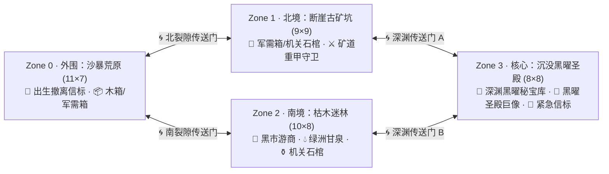

# 微观设计 II：荒原 2D 多区块传送门「搜 · 打 · 撤」肉鸽机制 (Micro Wasteland 2D Portal Extraction Roguelite)

> **层级定位**：`03-micro`（微观设计层 · 单局 2D 搜打撤肉鸽核心规则与行前增益卡库）  
> **职责边界**：定义 2D 多区块传送门互联地图、实时沙暴倒计时、移动最大频率冷却、五档宝箱读条交互、安全保险箱死亡保底机制、一次性可交易蓝图研习/销毁规则，以及 54 种行前增益卡轮抽机制。  
> **注**：当季专属的高阶装备目录 (`16 Raid Gear Specs`)、10 种一次性蓝图 (`bp_*`) 与 12 款限定动态外观 (`cos_*`) 掉率归属 [`04-seasons/s1-obsidian-awakening.md`](../04-seasons/s1-obsidian-awakening.md)。  
> **代码映射**：[`services/game/internal/domain/balance_raid_s1.go`](../../../services/game/internal/domain/balance_raid_s1.go)、[`services/game/internal/domain/micro_raid.go`](../../../services/game/internal/domain/micro_raid.go)、[`apps/web/src/WastelandRaidPanel.tsx`](../../../apps/web/src/WastelandRaidPanel.tsx)

---

## 0. 零信任服务端权威状态机与反作弊架构 (`Zero-Trust Server-Authoritative Raid Engine`)

为杜绝客户端伪造战利品或透视战争迷雾，单局荒原 2D 搜打撤采用**纯服务端权威状态机 (`ActiveRaidSession`)**：
- **服务端地图生成与迷雾裁剪 (`Fog-of-War Server Clipping`)**：`StartRaid` 时由服务端生成 4 区块 `9×9` 地图网格 (`RaidZoneState`)；在序列化响应 DTO (`RaidZoneViewDTO`) 时，所有 `Explored == false` 的格子统一被服务端脱敏裁剪为 `kind: "fog"`，客户端无法通过抓包获知未探明区域的宝箱或游商坐标。
- **步进式意图校验 (`POST /api/v1/empire/colony/raid/action`)**：前端仅发送玩家动作意图（`MOVE` / `LOOT_TILE` / `TAKE_CHEST_ITEM` / `MOVE_TO_SAFEBOX` / `USE_POTION` / `BUY_MERCHANT`），由服务端逐格校验曼哈顿距离 (`|Δx| + |Δy| == 1`)、墙体阻挡、实时沙暴倒计时 (`ExpiresAtUnixMs`)、CSPRNG 宝箱掉落以及安全保险箱/随身背囊容量。
- **权威撤离判定 (`POST /api/v1/empire/colony/raid/finish`)**：`FinishRaidReq` 不接受任何客户端战利品数组；当 `status == "EXTRACTED"` 时，服务端强制校验玩家当前坐标是否处于撤离信标 (`extract`) 格或相邻 1 格内，并仅结算服务端 `ActiveRaidSession` 中真实获取的背囊与安全箱战利品。

---

## 1. 多区块传送门连接 2D 地图架构 (`Multi-Zone Portal Topology`)

摒弃固定尺寸单图，每次点击【启程潜入荒原】(`StartRaid`) 时，系统基于权威随机种子 (`ActiveRaidSeed`) 生成 **4 个尺寸各异、由双向裂隙传送门 (`Portal 🌀`) 互联的 2D 生态区块**：

| 区块编号 | 区块名称 (`zoneName`) | 网格尺寸 (`W × H`) | 战争迷雾视野 | 核心探索交互物与生态定位 |
| :---: | :--- | :---: | :---: | :--- |
| `Zone 0` | **外围 · 沙暴荒原** | `11 × 7` | 基础半径 `2` | 初始出生点与常驻撤离信标 (`🚁`)；分布破旧木箱 (`📦`)、铁皮军需箱 (`🧰`) 与低阶沙匪 (`ATK 14`) |
| `Zone 1` | **北境 · 断崖古矿坑** | `9 × 9` | 基础半径 `2` | 岩壁掩体密集；盛产铁皮军需箱 (`🧰`)、远古机关石棺 (`⚱️`) 与矿道重甲守卫 (`ATK 24`) |
| `Zone 2` | **南境 · 枯木迷林** | `10 × 8` | 基础半径 `2` | 必刷**荒原黑市神秘游商 (`🧙`)**（可用局内古钱直接购买高阶蓝图或圣物匣）与恢复生命/时间的绿洲甘泉 (`💧`) |
| `Zone 3` | **核心 · 沉没黑曜圣殿** | `8 × 8` | 基础半径 `2` | 高危终局圣殿；盘踞黑曜圣殿巨像 (`ATK 38`)，集中分布**深渊黑曜秘宝库 (`💎`)** 与一座高危紧急撤离信标 (`🚁`) |

### 1.1 全屏 2D 搜打撤战场与裂隙战术小地图 (`Full-Screen Battlefield & Tactical Radar Minimap`)
- **全屏沉浸视口 (`.raid-fullscreen-viewport`)**：踏入裂隙后切换为全屏战场，左侧主区为 `9×9` 手绘矢量生态战棋盘（`.raid-map-grid`，每格 `64px×64px`，含领主当前格高亮、相邻可交互格脉冲边框、战争迷雾斜纹遮罩与微章标注）。
- **右侧常驻裂隙战术小地图 (`.raid-minimap-dock`)**：
  1. **四区块传送门拓扑带 (`.minimap-zone-topology`)**：实时显示 `Z1 ~ Z4` 四大生态区块的当前驻留状态与已踏足状态。
  2. **实时 `9×9` 像素雷达盘 (`.raid-minimap-grid`)**：以高对比战术色块实时标绘领主位置 (`minimap-player`)、星门传送阵 (`minimap-portal`)、撤离信标 (`minimap-extract`)、未开启宝箱 (`minimap-chest`)、局内游商营帐 (`minimap-merchant`)、存活魔物 (`minimap-enemy`)、黑曜岩壁 (`minimap-wall`) 与未探明迷雾 (`minimap-fog`)，并同步显示当前坐标 `(X, Y)` 与区域探明率 (`已探明 XX%`)。
- **三栏式搜刮与游商交互弹窗 (`.raid-loot-3col-sheet`)**：平时隐藏随身背囊；按 `B / Tab` 或搜开宝箱、踏入局内游商营帐时弹出「左：本季安全保险箱 + 随身背囊 / 中：领主四向披挂立绘 + 药水饮用 / 右：当前开启宝箱格子或局内游商易物台」三栏拖拽交互界面。

---

## 2. 实时倒计时、移动最大频率冷却与差异化宝箱读条

### 2.1 实时沙暴倒计时 (`TimeRemainingMs`)
- 每局不再限制固定移动步数，而是采用**全实时沙暴倒计时**（基础 **`180.0 秒`**，可通过行前时间类增益卡与绿洲甘泉延长至 `220~260 秒`）。
- 倒计时归零时尚未完成撤离信标读条，即判定为**荒原迷失 (`MIA`)**。

### 2.2 移动最大频率限制 (`MoveCooldownMs`)
- 玩家通过键盘 `W A S D` / 方向键或点击相邻格在 2D 网格上移动，每步移动受**最小冷却间隔 (`MoveCooldownMs`)** 限制：
  $$\text{MoveCooldown}_{\text{effective}} = \max\left(95\text{ ms},\; \text{Base}_{360\text{ms}} - \Delta_{\text{boots}} - \Delta_{\text{buffs}} - \Delta_{\text{potion}}\right)$$
- **移速手感阶梯**：
  - 赤足无靴基准：**`360 ms / 格`**（每秒最多移动 `2.78 格`）；
  - 穿戴 T1【麻布疾行靴】：**`285 ms / 格`**；
  - 穿戴 T2【墨械弹簧战靴】：**`215 ms / 格`**；
  - 穿戴 T3【赫尔墨斯风行羽靴】+ 疾风药水/行军卡：最快可达 **`95 ~ 155 ms / 格`**（丝滑高速穿梭，抢在沙暴闭合前横跨四个区块）。

### 2.3 五档交互目标搜索读条时间表 (`ChannelDurationMs`)
当玩家移动到宝箱或撤离信标格时，自动开启**原地读条进度条**（读条期间若主动移动，读条立即中断重置）：

| 交互目标类型 | 地图图标 | 基础读条耗时 | 巧手速搜合剂 (`-50%`) 后耗时 | 掉落池层级 |
| :--- | :---: | :---: | :---: | :--- |
| **破旧木箱 (`chest_wood`)** | `📦` | **`1.10 秒`** (`1100 ms`) | `0.55 秒` | 燧石结晶、局内古铜币 |
| **铁皮军需箱 (`chest_iron`)** | `🧰` | **`2.20 秒`** (`2200 ms`) | `1.10 秒` | 古文明残片、古金币、低概率二阶蓝图 (`bp_*`) 与稀有(`Rare`)外观 |
| **远古机关石棺 (`chest_coffin`)** | `⚱️` | **`3.60 秒`** (`3600 ms`) | `1.80 秒` | 中高概率二/三阶装备与安全箱蓝图 (`bp_*`)、稀有(`Rare`)/史诗(`Epic`)动态外观 |
| **深渊黑曜秘宝库 (`chest_abyss`)** | `💎` | **`5.40 秒`** (`5400 ms`) | `2.70 秒` | 核心圣殿重宝：高权重检定三阶泰坦蓝图 (`bp_*`)，极低概率 (`0.22%~0.85%`) 孕育当季传世(`Legendary`)动态外观 |
| **呼叫撤离信标 (`extract`)** | `🚁` | **`2.80 秒`** (`2800 ms`) | `1.40 秒` | 读条完成至 `100%` 瞬间安全撤离 (`EXTRACTED`)，带走背囊与安全箱全部战利品 |

---

## 3. 安全保险箱保底与一次性可交易蓝图机制

### 3.1 普通背囊 vs 本赛季安全保险箱 (`SafeBox`)
- **普通背囊 (`BackpackCapacity`)**：基础 `6 格`（可通过行前增益卡扩至 `8~10 格`）。仅在**成功撤离 (`EXTRACTED`)** 时带回主城；若生命归零或超时 (`MIA`)，普通背囊内战利品全部遗失，且当前穿戴的武器、护甲、战靴损毁遗失。
- **本赛季安全保险箱 (`SafeSlotCount`)**：
  - 初始自带 **1 格【贴身皮质暗袋】**；通过局内寻获或市场购买蓝图，可打造升级为 **2 格【加固铁皮安全箱】**、**3 格【墨械密码保险箱】** 乃至 **5 格【泰坦次元保险箱】**。
  - **100% 死亡保底**：玩家在局内摸出极品传世外观 (`cos_*`) 或高阶蓝图 (`bp_*`) 的瞬间，可在右侧背囊栏一键将其移入【安全保险箱】。即使随后遭遇巨像阵亡或沙暴超时 (`MIA`)，**安全保险箱内的物品 100% 安全带回主城仓库，且安全保险箱本身本赛季永不损毁**。

### 3.2 一次性使用可交易蓝图 (`Single-Use Tradable Blueprints`)
- **低阶装备 (T1)**：无需蓝图，随时直接消耗聚落基础资源（水/木/炭/石/燧石）打造。
- **高阶装备与安全箱 (T2 / T3)**：必须先在局内宝箱搜出或在现货市场买到对应的**一次性蓝图道具 (`bp_*`)**。
- **研习销毁 vs 现货交易**：
  1. **自由交易**：未使用的蓝图 (`bp_*`) 存放在仓库中，可在现货市场自由挂单买卖 (`BID / ASK`)。
  2. **研习销毁 (`LearnRaidBlueprint`)**：点击【研习蓝图】后，**该张蓝图道具立即销毁 (`-1`)**，同时该玩家在**本赛季内永久解锁该装备的打造权限**（此后只要消耗聚落水/木/炭/石/燧石即可无限次重铸该装备）。

---

## 4. 行前 54 种增益卡三选一轮抽池 (`54 Pre-Departure Buff Cards`)

每次启程前，玩家可在【行前整备台】从随机刷出的 **3 张增益卡中选择购买**，或花费少量 `水 + 木材` 刷新下一批。每局最多携带 **4 张增益卡 (`MaxEquipped = 4`)**。
- **防通胀铁律**：54 张增益卡严禁出现任何「100% 必掉外观」词条，全部围绕以下 **6 大战术维度（每类 9 张，共 54 张）** 构建：

| 类别代码 | 类别名称 | 卡牌编号区间 | 包含的 9 张增益卡名称（完整数值见 `raid_catalog.go`） | 核心作用机制 |
| :--- | :--- | :---: | :--- | :--- |
| `time` | **时序与移速** | `#01 ~ #09` | `轻装急行`、`定风沙漏`、`水利增压靴`、`流沙踏板`、`绿洲信标`、`疾风引流`、`发条加速器`、`风暴预言`、`超时空锚点` | 缩减单格移动冷却 (`-20ms ~ -65ms`)、延长当局沙暴倒计时 (`+15s ~ +45s`) |
| `vision` | **视野与侦察** | `#10 ~ #18` | `高空斥候鹰`、`荧光石粉`、`矿道测绘仪`、`迷林向导`、`传送门共鸣仪`、`热能感应镜`、`圣殿星图`、`回声探针`、`全频雷达阵` | 扩大战争迷雾视野半径、揭示全区传送门或高阶石棺/秘宝库方位 |
| `scavenge` | **巧手与开箱** | `#19 ~ #27` | `涂油撬棍`、`液压破锁器`、`巧手皮套`、`扩容行军囊`、`重型背架`、`机关解构图谱`、`声波共振仪`、`泰坦万用钥`、`次元折叠袋` | 缩减宝箱与撤离点读条耗时 (`-15% ~ -42%`)、扩充单局普通背囊格数 (`+1 ~ +3 格`) |
| `offense` | **战技与伏击** | `#28 ~ #36` | `燧石淬毒`、`黑火药包`、`穿甲重矢`、`高压水刃`、`狂战烙印`、`弱点洞悉`、`雷霆附魔`、`巨像克星`、`泰坦神力` | 提升荒原攻击力 (`+6 ~ +32 ATK`)，降低遭遇精英守卫与圣殿巨像时的战损 |
| `defense` | **护盾与生还** | `#37 ~ #45` | `藤编护心镜`、`石肤涂剂`、`净水再生壶`、`硬壳甲片`、`蒸汽偏折盾`、`荆棘反甲`、`裂隙治愈光`、`不屈意志`、`金蝉脱壳符` | 提升生命上限 (`+20 ~ +85 HP`) 與护甲减伤 (`+3 ~ +16 DEF`) |
| `tactical` | **奇遇与黑市** | `#46 ~ #54` | `游商暗号信物`、`古钱磁石`、`摸金校尉笔记`、`寻宝灵鼠`、`保险箱夹层`、`黑市贵宾卡`、`双生火把`、`古物鉴定镜`、`荒原幸运星` | 降低局内黑市游商售价、临时增加 `+1` 安全箱格、微幅提升蓝图检定权重 (`+10%~+35%`) |

## 5. 会话、整备和指令一致性

每位玩家只能存在一局活跃远征；超时旧局也必须先按 MIA 结算才能重新出发。局内禁止打造、穿脱整备及轮抽增益，因此战斗属性、背囊/保险箱容量和 MIA 装备损失都使用同一入场配置。基础出发不另加新费用，资源消耗仍来自整备和增益卡。

地图种子仅存于服务端。客户端拿到随机不透明 `raidId` 和已探索内容；动作携带该 ID 与递增指令序号。相同最后指令重试无副作用，过期或跨局指令拒绝；最近 16 次终局指令回执持久保留。物品转移先验证源/目标容器和容量，失败不移除物品。

长期移速按完整有效冷却补充，最多容忍一秒累计突发，不以 50% 冷却持续放行。疾风药水使用数值表 `GalePotionCooldownMs=105ms`，前后端共用服务端返回的冷却。站上宝箱/信标时服务端冻结 `channelReadyAt`，同一或倒退时间戳均不能绕过；移动重置读条。撤离要求站在开放信标格并完成全程读条，沙暴截止时间优先于撤离。前端以单调截止时间显示倒计时，并按玩家版本号合并当前区域补丁，终局后刷新一次全量库存。

## 聚落前期衔接

斥候营是研究烧炭并建成炭窑后的可选设施，需另付建设成本。聚落毕业不依赖进入荒原或抽中 `bp_*`。游商驿站已独立建造。S1 基础长矛改为 80 水 + 60 木、防沙衣 100 水 + 40 木；更高阶整备仍需持续建设仓储与产线。MIA 装备损毁、权威结算及输出边界不变，详见 S1 目录与聚落生产文档。
